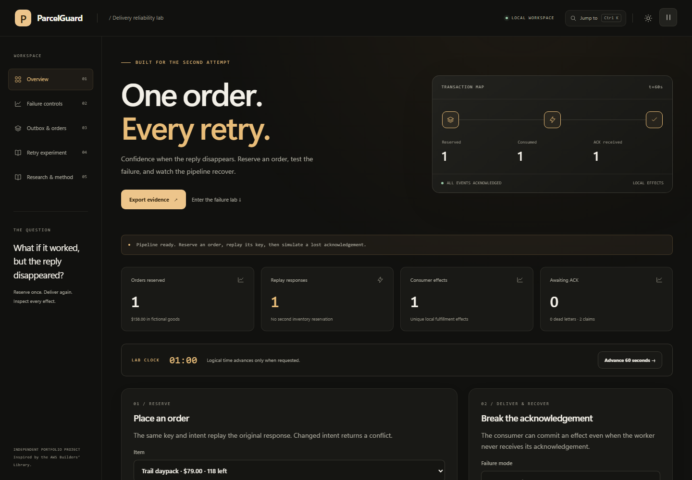

# ParcelGuard

A local order reliability lab. Reserve inventory once, replay a client request, lose a delivery acknowledgement after the consumer commits, and verify that recovery creates one local fulfillment effect. Compare retry strategies on paired synthetic workloads. Inspired by the AWS Builders' Library.



## Public demo and release checks

[Interactive demo](https://chauhanavi21.github.io/parcelguard/) | [Captioned walkthrough](https://chauhanavi21.github.io/parcelguard/watch.html) | [CI](https://github.com/chauhanavi21/parcelguard/actions). The browser demo uses the same Python domain logic with temporary per-tab state. See [release evidence](docs/RELEASE.md) for its limits, three-engine checks, accessibility/mobile measurements, and historical-data replay.

## Run

Python 3.11 or newer. No runtime packages, credentials, cloud resources, or build step.

```powershell
cd parcelguard
python server.py
```

Open http://127.0.0.1:8772. Stop a foreground server with Ctrl+C. Optional arguments: `--port 8782 --db runtime/another-demo.sqlite`. The default `runtime/orders.sqlite` persists across restarts. Use another database path for a fresh lab. No external orders, payments, or deliveries are created.

The commands above start from the repository root containing `parcelguard/`. If you are already in that application folder, run `python server.py` directly. The [recruiter guide](../RECRUITER_GUIDE.md) covers the repository workflow and source ZIP.

## Try the project

1. Reserve an order with a new idempotency key.
2. Submit the same key and quantity again. The response replays; stock and order counts stay unchanged.
3. Change the quantity with the same key: the server returns conflict. Use **New key** for a distinct order.
4. Select **Lose ACK after consumer commits**, then deliver one due event. Consumer effects becomes one, but the outbox awaits acknowledgement.
5. Advance 60 seconds, select healthy delivery, and deliver again. The duplicate is suppressed; effects remains one and the outbox becomes sent.
6. Compare retry strategies with different client counts, capacities, and seeds. Read completion alongside latency.

The worker uses explicit logical time, a 30-second lease, capped full jitter, and at most **eight claims per event**. Exhausted events remain visible as dead letters; this prototype has no redrive control. The separate simulation gives each client at most **six attempts**.

## Actual experiment result

Default synthetic contention: 120 simultaneous clients, capacity 15 attempts per 100 ms, seed 42, 95% healthy-attempt success probability.

| Strategy | Completed | Total attempts | Attempts/client | Successful-client p95 |
|---|---:|---:|---:|---:|
| Immediate retry | 14 / 120 | 650 | 5.42 | 25 ms |
| Exponential backoff | 87 / 120 | 506 | 4.22 | 6,225 ms |
| Full jitter | 120 / 120 | 372 | 3.10 | 1,118 ms |

Immediate retry's apparently excellent latency excludes its 106 failed clients. Under spare capacity, all strategies complete all clients in this study, and immediate retry can recover faster. Read the [two-workload, three-seed findings](docs/FINDINGS.md); these are synthetic model outputs, not AWS performance measurements.

## Interface and motion

The redesigned workspace includes light/dark themes, animated data views, scroll-triggered reveals, sticky section navigation, keyboard section search (Ctrl+K / Cmd+K), and a persistent motion control. System reduced-motion preferences are respected. See the [interface notes](docs/INTERFACE.md) for controls, implementation, and verification scope.

## Verify

```powershell
python verify.py
```

This runs **22 core/HTTP tests** and regenerates [order-evidence.json](artifacts/order-evidence.json), [retry-study.json](artifacts/retry-study.json), and [verification.json](artifacts/verification.json). Coverage includes concurrent duplicate requests/workers, restart persistence, atomic rollback, changed-intent conflicts, lost ACK recovery, expired leases, exhausted attempt budgets, malformed HTTP requests, and simulation reproducibility.

Optional browser verification:

```powershell
python -m venv .venv
.\.venv\Scripts\python.exe -m pip install -r requirements-dev.txt
.\.venv\Scripts\python.exe -m playwright install chromium
.\.venv\Scripts\python.exe browser_check.py
```

An existing Chromium can be selected with `--browser-path "C:\path\to\chrome.exe"`. The [browser report](artifacts/browser-checks.json) records **33 passing checks**, including create/replay/conflict, lost ACK recovery, logical time advancement, experiment controls, export, and layouts at 1440, 1024, and 390 px. No uncaught JavaScript errors or HTTP 5xx responses occurred. Browser checks use an isolated temporary database.

## Research and implementation

- [AWS: Making retries safe with idempotent APIs](https://aws.amazon.com/builders-library/making-retries-safe-with-idempotent-APIs/) informed client tokens, intent comparison, and saved responses.
- [AWS: Timeouts, retries, and backoff with jitter](https://aws.amazon.com/builders-library/timeouts-retries-and-backoff-with-jitter/) informed bounded retry amplification and jitter experiments.

Both sources were retrieved successfully on November 14, 2026. See the [research and design](docs/RESEARCH_AND_DESIGN.md) for the completed plan, architecture, and explicit choices.

The backend uses Python/SQLite; the frontend uses HTML/CSS/JavaScript. The architecture patterns are the relevant evidence; this does not assert that Amazon requires a particular language. It uses no AWS services or credentials.

## Scope

The idempotency scope is one fictional client (`demo-shop`) and keys never expire. The consumer commits in a separate transaction within the same SQLite database. Unique event IDs prevent duplicate local effects; this is not a global exactly-once guarantee. There is no autonomous worker, distributed network, external payment/carrier, multi-region replication, or production load test. This independent prototype is not company-endorsed and implies no hiring outcome.
