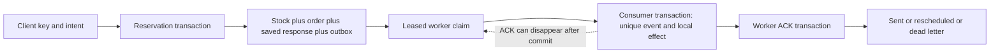

# ParcelGuard: research, plan, and design

Research date: November 14, 2026. Focus: software engineering and analytics. The sources describe public distributed-systems practices; they do not prove an open Amazon project, a company-wide language preference, or recruiter endorsement.

## The decision

Build a small order reservation pipeline that can demonstrate ambiguous completion. **If the first attempt succeeded but its acknowledgement was lost, can a retry avoid repeating the business effect?** Then measure retry load and completion under controlled contention. This creates both a systems demonstration and an analytical experiment.

## Public sources and implemented consequences

| Primary source | Relevant guidance, paraphrased | Local consequence |
|---|---|---|
| [Making retries safe with idempotent APIs](https://aws.amazon.com/builders-library/making-retries-safe-with-idempotent-APIs/) | Caller-provided request identifiers express intent. Replays should yield semantically equivalent results, and the same identifier with different parameters needs explicit handling. Token retention and atomic recording matter. | Client-scoped key, canonical intent hash, saved original response, conflict on changed intent, and atomic reservation/order/response/outbox. Retention is explicitly indefinite in this prototype. |
| [Timeouts, retries, and backoff with jitter](https://aws.amazon.com/builders-library/timeouts-retries-and-backoff-with-jitter/) | Failures can occur after a side effect; retries add load and may synchronize. Bound attempts and use backoff/jitter with care. | Lost-ACK and pre-consumer fault modes, leased worker claims, bounded attempts, capped full jitter, and paired discrete-event experiments. |

Both sources returned HTTP 200. [research-sources.json](../artifacts/research-sources.json) records a fresh retrieval and content hashes. SQLite, the outbox/consumer schema, eight-claim worker budget, exact retry delays, synchronized capacity model, and six-attempt experiment budget are project choices, not copied Amazon production configuration.

## Completed plan

1. Define intent, side-effect, and failure boundaries → this document and core schema.
2. Implement atomic reservation/idempotency/outbox → core tests before UI.
3. Implement leased claims, separate consumer commit, and lost-ACK recovery → failure and concurrency tests.
4. Build live controls, state tables, delivery log, experiment comparisons, and export → `web/`.
5. Measure multiple seeds under contention and spare capacity; run HTTP/browser checks → `evidence.py`, `verify.py`, `browser_check.py`, `artifacts/`.

## Architecture and transaction boundaries

An order is scoped to fictional client `demo-shop`. Within `BEGIN IMMEDIATE`, an existing key either replays its saved response or conflicts if its intent hash differs. A new request checks available inventory and atomically decrements stock, writes the order, records the response, and creates one outbox event. No half-reservation should survive the injected failure before the outbox write.

Order API responses intentionally replay the original accepted status even after fulfillment advances. Current order state is available from the workspace endpoint. This makes the original response stable rather than reconstructing it from changing state.

Delivery has separate claim, consumer, and acknowledgement transactions. The consumer inserts a unique event ID and updates the order stage together. If the acknowledgement is lost, retrying the event finds the recorded event ID and suppresses the duplicate effect. An event can be delivered more than once; its local effect commits once under the demonstrated database constraint.

Claims last 30 logical seconds. An expired claim is reclaimable, and an attempt number prevents an old worker from acknowledging or rescheduling a newer claim. There are at most eight claims per event, including abandoned claims. Failed claims reschedule with deterministic per-event/attempt full jitter in `[0, min(32s, 1s * 2^(attempt-1))]`; exhaustion leaves a visible dead letter. A dead letter can have a committed consumer effect if the last acknowledgement was lost. No automatic redrive or distributed lease service is implemented.

The worker runs only when the user requests a step. Time advances only through the explicit clock control. The consumer is a separate transaction in the same local SQLite database, not an external carrier or payment API. The model demonstrates durable state and ambiguity without claiming end-to-end exactly-once delivery.

## Retry experiment contract

This separate discrete-event model starts all clients at time zero. Capacity is a fixed number of attempts per 100 ms slot. Attempts beyond capacity fail; otherwise a keyed pseudo-random draw succeeds with 95% probability. Each client gets at most six attempts. Successful latency includes a fixed 25 ms service time.

- Immediate retry schedules the next attempt 1 ms later.
- Exponential backoff waits `min(3200ms, 200ms * 2^attempt)`.
- Full jitter samples an integer delay from 1 ms to that same bound.

All strategies receive the same per-client/per-attempt service draws. Jitter has a separate random stream, so its draw count does not change the service outcomes. Capacity availability still depends on the schedule, as intended. Equal-time events use a stable client-ID ordering; there is no fairness model. There is no adaptive capacity, real network latency, autoscaling, retry quota, correlated outage process, or multi-layer retry stack.

Compare completion and total attempts first. p95 is conditional on successful clients and excludes failures, so a strategy that quickly gives up can appear deceptively fast. Three seeds under two workloads illustrate sensitivity; they do not support production performance estimates or universal rankings.

## API and verification

| Route | Behavior |
|---|---|
| `POST /api/orders` | Requires `Idempotency-Key`; 201 created, 200 replay, 409 changed intent or stock shortage |
| `POST /api/dispatch` | One to ten worker claims with explicit fault mode |
| `POST /api/advance` | Advance logical time by 1–3600 integer seconds |
| `POST /api/experiment` | Validated seed, client count, and capacity → computed strategy results |
| `GET /api/workspace` | Inventory, orders, outbox, log, and stock/count checks |
| `GET /api/health` | Health and version |

Core tests exercise atomic rollback, concurrent same-key requests, concurrent consumers, restart persistence, lease recovery, both injected failures, attempt exhaustion, validation, and deterministic bounded experiments. Real HTTP tests verify status semantics and malformed input. Browser checks reproduce create/replay/conflict and lost-ACK recovery, change experiment parameters, download evidence, and inspect three viewport widths.

## Scope and next useful extension

Python/SQLite keeps the state transitions and analysis inspectable with no cloud bill or runtime dependency. There is no invented requirement to use Amazon's presumed internal stack. A useful extension would move the consumer to a separate service/database, persist its inbox there, and inject process crashes and network failures around an actual RPC. That would test failure boundaries this single-machine model deliberately does not cover. Any key-expiration policy would also need an explicit retention contract before being added.
